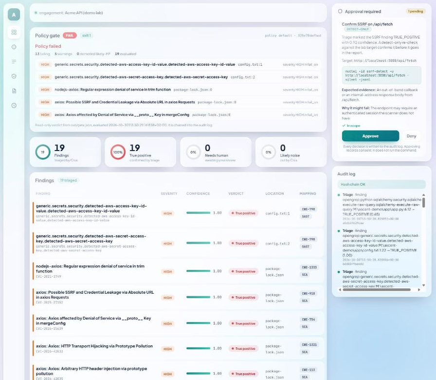
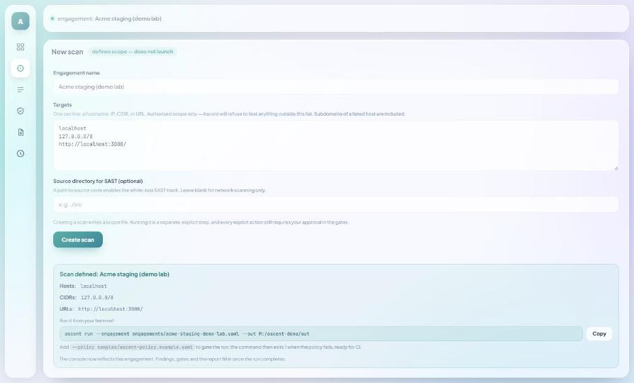
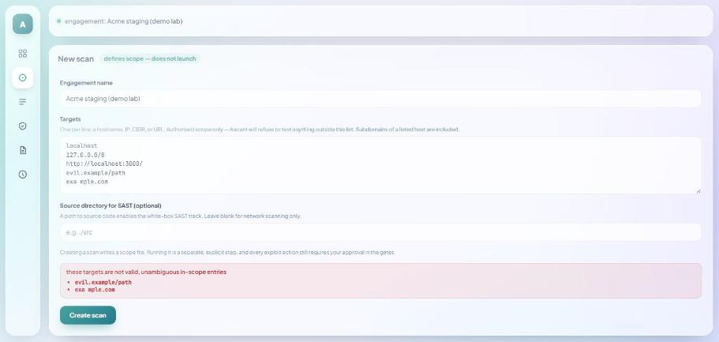
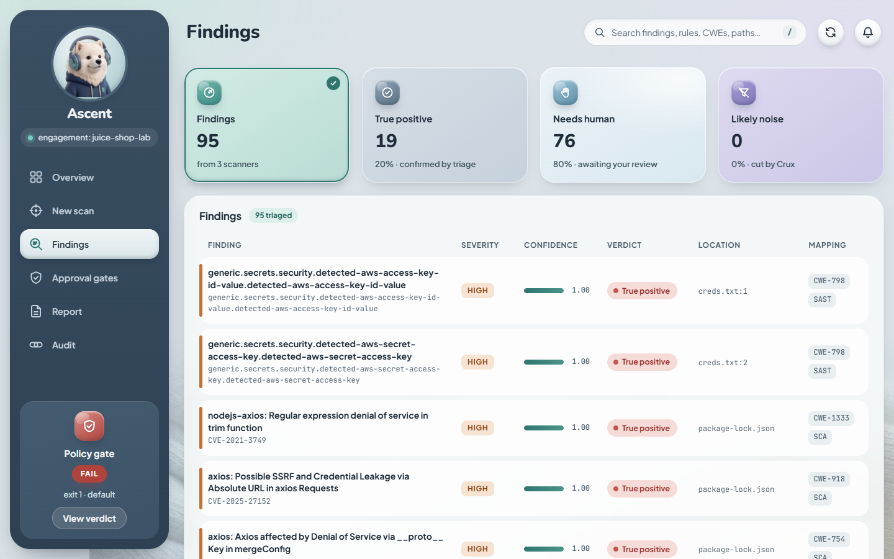
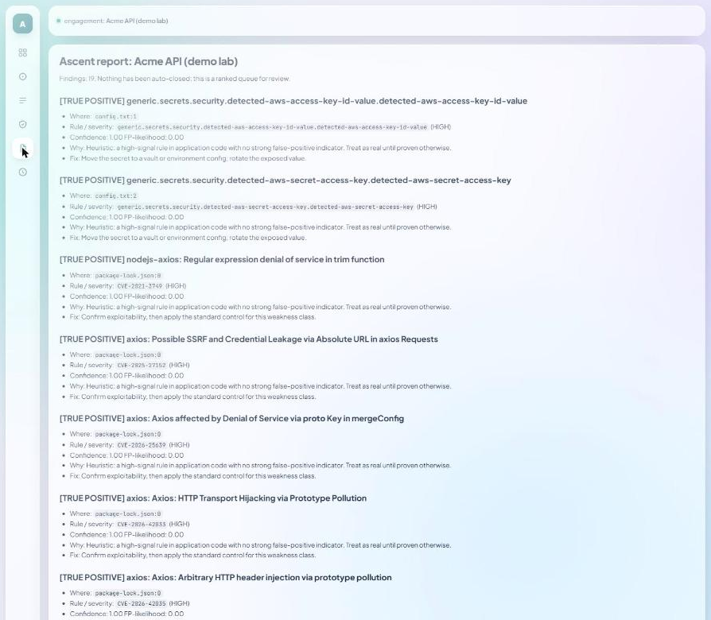
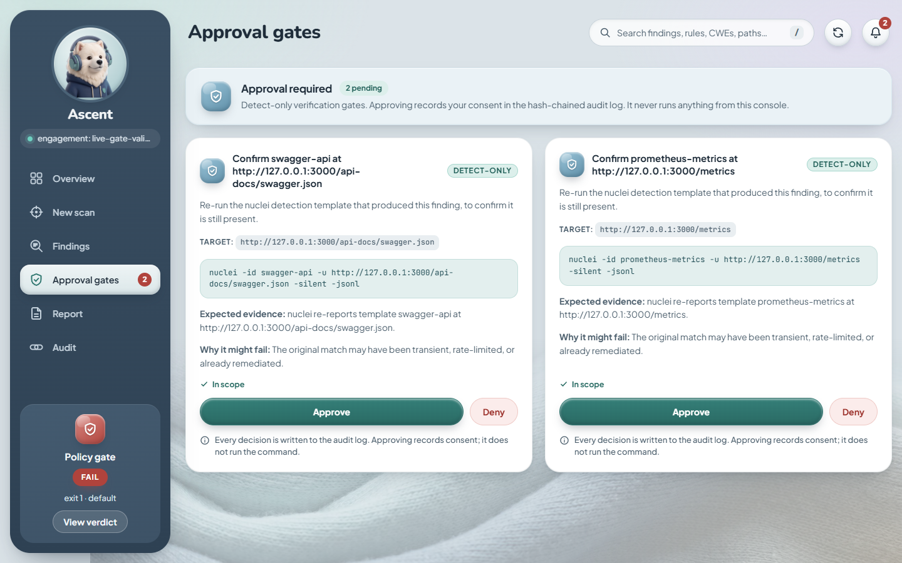

# Ascent

Ascent is an open-source (Apache-2.0), scope-enforced, human-in-the-loop AppSec pipeline written in Rust. It drives external open-source scanners as subprocesses (opengrep, gitleaks and trivy for source code; nuclei with httpx and katana for running web targets), triages the findings with the offline [Crux](https://github.com/Aldiharley/crux) engine, and produces a ranked report, a hash-chained audit log and native SARIF 2.1.0. A YAML policy turns the result into a CI-friendly verdict. Every network target passes a fail-closed scope guard, and nothing is ever exploited automatically: a human approves each detect-only verification step in a local dashboard.



*The Overview screen after an authenticated lab run (OWASP Juice Shop on 127.0.0.1 plus a planted SAST fixture): 95 triaged findings in verdict tiles, and the policy gate failing on the planted secrets and vulnerable dependencies. Further down, the screen shows severity and verdict charts, top findings, pending approval gates and the recent audit log.*

Use Ascent only against systems you own or have explicit written permission to test.

## How it works

1. **Scope.** An engagement file lists the hosts, CIDRs and URLs you are authorised to test (and optionally a source directory). Every target is checked against it before any network request; an ambiguous or out-of-scope target is refused.
2. **Scan.** Ascent invokes the external scanners as subprocesses: opengrep (SAST), gitleaks (secrets) and trivy (SCA) over source, and nuclei (with httpx/katana) over in-scope web targets.
3. **Triage.** The offline Crux engine labels each finding TRUE_POSITIVE, NEEDS HUMAN or LIKELY NOISE, with a confidence.
4. **Policy gate.** A YAML policy yields PASS, CONDITIONAL, FAIL or INCOMPLETE, with an exit code for CI. A crashed or missing scanner never passes.
5. **Human-approved verification.** For confirmed-looking DAST findings Ascent can propose a detect-only re-check. It runs only after a person approves it in the dashboard.
6. **Report, SARIF and audit log.** The run writes `report.md`, `ascent.sarif` / `ascent-dast.sarif`, and `audit.jsonl`, a hash-chained log in which any tampering is detectable.

## Quick start

Prerequisites: a Rust toolchain, Node.js and npm. Crux is a path dependency, so check it out next to Ascent (see [Building](#building)).

1. **Build.**

   ```
   cargo build
   cd frontend && npm ci && npm run build && cd ..
   ```

2. **Start the dashboard** from the repo root, and open <http://127.0.0.1:8787>:

   ```
   cargo run --bin dashboard
   ```

   It is fine for it to be empty before the first run. It reads results from `out/` (`ASCENT_OUT` changes that).

3. **Define a scan.** Open New Scan, enter the targets you are authorised to test (for example `127.0.0.0/8` and `http://127.0.0.1:3000/` for a lab such as OWASP Juice Shop running locally; use `127.0.0.1` rather than `localhost`, which ProjectDiscovery tools may not resolve) and optionally a source directory for SAST. Pick a DAST profile (passive, standard or active; the default is standard, and `active` adds intrusive templates and parameter fuzzing, so use it only on targets you may actively test). For an authenticated scan you can also give an auth header name and the name of the environment variable that holds its value (never the value itself); see [DAST track](#dast-track). Ascent validates the input and writes an engagement scope file under `engagements/`. This screen only defines scope and settings; it never launches a scan. It shows the exact command to run:

   | Scope defined, with the command to copy | Ambiguous targets refused, nothing written |
   |---|---|
   |  |  |

4. **Run it from the terminal**, with the policy gate. The engagement path is the one the New Scan screen printed (`ascent run` is the installed CLI; from a checkout use `cargo run -- run`, or install it with `cargo install --path .`):

   ```
   cargo run -- run --engagement engagements/<name>.yaml --out out --policy samples/ascent-policy.example.yaml
   ```

   The process exit code follows the verdict (see [Policy gate and CI](#policy-gate-and-ci)). With DAST scope the run also prints a `dast:` line (profile, authenticated or not, and how many URLs were seeded, crawled, dropped as out of scope, scanned and unreachable), a `nuclei:` line (templates excluded, requests sent, failed requests, requests outside scope) and the path of `dast-coverage.json`. The lab must be running: if a declared URL does not answer, nothing could be scanned, most requests to the target failed, or nuclei sent any request outside scope, the run is INCOMPLETE (exit 3) and says why.

5. **Review in the dashboard.** Refresh <http://127.0.0.1:8787> to see the policy verdict, the triaged findings, the report and the audit log.

Scanners are external. Ascent does not bundle them; install them on your `PATH`.

- **SAST track** (source directory): [opengrep](https://github.com/opengrep/opengrep), [gitleaks](https://github.com/gitleaks/gitleaks) and [trivy](https://github.com/aquasecurity/trivy). A scanner that is not installed is skipped, but a policy that needs its category then ends INCOMPLETE (exit 3).
- **DAST track** (hosts or URLs): [nuclei](https://github.com/projectdiscovery/nuclei), ProjectDiscovery [httpx](https://github.com/projectdiscovery/httpx) and [katana](https://github.com/projectdiscovery/katana) are required, plus [subfinder](https://github.com/projectdiscovery/subfinder) when a host is a dotted DNS name. A missing one fails the run with exit 3. On Windows, a pip-installed Python `httpx` can shadow ProjectDiscovery httpx on `PATH`; make sure the ProjectDiscovery binary is the one found first.

To try it, start a local lab first (for example OWASP Juice Shop published on `127.0.0.1:3000`), then run the sample engagement: `cargo run -- run --engagement samples/engagement.example.yaml --out out --policy samples/ascent-policy.example.yaml`. It targets `http://127.0.0.1:3000/` on the local machine only; with no lab running the run is INCOMPLETE (exit 3), because nothing could be tested.

## Safety model

- **Authorised targets only.** Scope is declared up front in the engagement file and every network target is checked against it, fail closed. nuclei templates whose `@Host:` names another host, that have any non-http section, or whose `flow:` loads a JavaScript module, are excluded before the scan, and every http request nuclei recorded in its trace log is audited afterwards: any request outside scope makes the run INCOMPLETE (see [Requests outside the target](#requests-outside-the-target)).
- **Nothing exploits automatically.** The only thing Ascent ever runs against a target after triage is an allow-listed, detect-only `nuclei -id <id> -u <url> -silent -jsonl` re-check, and only after a recorded human approval.
- **Approval is recorded, tamper-evident and bound to the gate.** Each decision is chained into `audit.jsonl` together with the hash of the gate as approved; an edited gate is refused at execution. A failed chain check makes the CLI exit 4 and the dashboard stop accepting decisions.
- **The dashboard is local and read-mostly.** It binds to loopback only, shows findings, the policy verdict, the report and the audit log, and records approve/deny decisions. It never launches a scan.

Details for each of these are in the sections below.

## Invoke, don't vendor

Ascent drives external open-source scanners (subfinder, httpx, katana, nuclei) as subprocesses through a scope-checked runner. They are invoked, never vendored or linked into the Ascent binary.

Triage uses [Crux](https://github.com/Aldiharley/crux), the author's Apache-2.0 triage engine, linked as a library (`crux = { path = "../crux", default-features = false }`). With default features off, Crux's HTTPS client is compiled out, so the `ascent` CLI binary links no network code and triage runs Crux's offline `MockTriager`. The separate `dashboard` binary serves loopback-only HTTP (see below).

## Building

Crux is a path dependency, so check it out next to Ascent:

```
Projects/
  Ascent/
  crux/
```

Then run `cargo test` in `Ascent/`.

## SAST track

Besides the black-box (DAST) track, Ascent can run a white-box source-analysis (SAST/SCA/secrets) track over a source directory. It invokes [opengrep](https://github.com/opengrep/opengrep), [gitleaks](https://github.com/gitleaks/gitleaks) and [trivy](https://github.com/aquasecurity/trivy) as subprocesses; like the DAST tools, they are invoked, never vendored. Install whichever you want on your `PATH`. Tools that are not installed are skipped, and the run still completes (with fewer or no SAST findings). With a policy, though, a missing analyser for one of the policy's `fail_on.categories` (opengrep → SAST, gitleaks → SECRETS, trivy → SCA) makes the gate INCOMPLETE (exit 3): an unscanned category never passes.

Point the track at a source root either way:

- add `source: <dir>` to the engagement YAML, or
- pass `--source <dir>` (overrides the engagement's `source`; it must stay inside the engagement's authorised source root).

```
cargo run -- run --engagement samples/engagement.example.yaml --out out --source path/to/repo
```

SAST findings join the DAST queue and flow through the same triage, `report.md` and audit log. With no hosts or urls in scope, the DAST track is skipped and only the SAST track runs. Findings from gitleaks are redacted: the secret value is never stored.

**Your source never leaves the machine**, and no analyser is ever pointed at a network target (SAST runs locally over files). But note the analyser *subprocesses* make their own outbound calls that Ascent does not gate: opengrep's `--config auto` fetches rules from the opengrep registry (telemetry is disabled with `--metrics=off`), and `trivy fs` updates its vulnerability database from a registry. Neither sends your source or engagement targets anywhere. For an air-gapped or fully governed run, use a pinned local opengrep ruleset and `trivy --skip-db-update --offline-scan` (a planned follow-up; see `docs/followups-sast.md`).

## DAST track

The DAST track tests running web targets with [nuclei](https://github.com/projectdiscovery/nuclei), after ProjectDiscovery httpx probes the hosts and katana crawls them. It runs when the engagement lists `hosts` or `urls`. This section describes what it covers, and what it deliberately does not.

### How the surface is built

- **The whole declared scope is used.** The seed is every host (through recon) plus every URL in the engagement, de-duplicated. Hosts and URLs are no longer alternatives: a URL is scanned even when hosts are also listed.
- **Liveness probe per URL.** Every declared URL is probed with ProjectDiscovery httpx (`-silent -json -rl 50`, no auth header, no redirect following). Only URLs that answer are crawled. A declared URL that does not answer makes the run INCOMPLETE (see [Policy gate and CI](#policy-gate-and-ci)): declared scope that was not tested never passes.
- **Recon per host.** Each host is probed with httpx on the default web ports. subfinder runs only for real DNS names (a name with at least one dot that is not an IP literal); `localhost`, other single-label names and IP addresses are probed directly. subfinder queries public passive sources (certificate transparency logs, DNS datasets and similar) about the domain, so the domain name leaves the machine even though no request goes to those names. Every name it returns is scope-checked before httpx probes it; an off-scope or invalid name (such as `_dmarc.example.com`) is dropped and counted.
- **Crawl.** katana crawls the live seeds with `-fs fqdn`, so it stays on the exact hostnames it was given (katana's own default is the whole root domain, which Ascent does not use). It also runs with `-jc` (parse endpoints out of JavaScript files, which a single-page app needs), `-rl 50` and `-dr` (no redirect following).
- **Scope filter.** Seeds and crawl results that the scope guard does not accept are dropped, counted and never sent to a scanner. A crawl that finds links to GitHub or a CDN no longer aborts the run. The counts are printed and stored in `run.json` under `dast`: `seeded` (live seeds), `crawled` (new endpoints katana found), `out_of_scope_dropped`, `scanned`, and `reachable`, `unreachable` and `unreachable_urls` for the declared URLs.
- **Use `127.0.0.1`, not `localhost`.** ProjectDiscovery tools may fail to resolve `localhost` even where curl and browsers can, and nuclei then reports nothing. The probe catches this: the run is INCOMPLETE with a hint to use `127.0.0.1`.

### Profiles

Set the profile in the engagement file (`dast.profile`) or in the New Scan screen. The default is `standard`.

```yaml
dast:
  profile: standard   # passive | standard | active
```

| Profile | nuclei tags | Also excluded | Extra pass |
|---|---|---|---|
| `passive` | `tech, misconfig, exposure, headers, cors, cookie, session` | `intrusive, fuzz` | none |
| `standard` (default) | the passive tags plus `cve, sqli, xss, auth-bypass, jwt, idor, csrf, redirect, ssrf, lfi` | `intrusive, fuzz` | none |
| `active` | same as standard | `fuzz` in the first pass (`intrusive` templates run) | a second `nuclei -dast` pass (parameter-fuzzing templates) over the same surface |

`standard` never runs templates tagged `intrusive` (they attempt state-changing chains such as remote code execution or file writes, for example the MOVEit CVE-2023-34362 template). Only `active`, the opt-in profile for targets you may change, runs them.

Every pass of every profile uses `-rate-limit 50` (50 requests per second), `-concurrency 10`, `-timeout 10`, `-ni` (no interactsh, so no out-of-band traffic to a third-party OAST server), `-duc` (no update check), `-dr` (no redirect following, so a redirect cannot take nuclei off scope), `-pt http` (templates whose first protocol is http; the `-dast` fuzzing templates are http too) and `-nmhe`. nuclei types a template by its FIRST protocol, so `-pt http` alone still runs templates that start with an `http:` section and then dial something in a `javascript:`, `network:`, `ssl:` or other non-http section, Ascent therefore also excludes every template with any top-level non-http section, and every template whose `flow:` loads a JavaScript module (see [Requests outside the target](#requests-outside-the-target)). Without `-nmhe`, nuclei skips a host for every later template once it has had 30 errors (`-max-host-error`), and under `-silent` it says nothing: on a live Juice Shop run a few failing templates made nuclei silently skip the target, and the run reported 1 finding instead of hundreds. Every pass also always excludes the tags `dos`, `brute-force` and `default-login`. These exclusions are fixed in code, and the engagement file cannot change them. A nuclei configuration file of your own (for example `~/.config/nuclei/config.yaml`) is still read by nuclei and could re-include excluded tags, so keep it free of tag settings. The scope-checked URL list reaches nuclei as a temporary file (`-l`), which is deleted afterwards.

`active` runs intrusive templates and sends fuzzing payloads at every parameter it finds, so use it only on targets you are allowed to test actively. Findings from both `active` passes are merged and de-duplicated by template id, matcher name, matched URL and fuzzed parameter, so a template with several matchers yields one finding per matcher. Findings from the fuzzing pass are recorded as tool `nuclei-dast`. They are reported and gated like any other finding, but they are never proposed for detect-only verification, because a single-template re-run cannot reproduce a fuzzed request. When both passes find the same hit, the template-pass copy is kept, so it stays verifiable.

### Requests outside the target

The scope guard checks every target Ascent hands to a tool, but a nuclei template can send a request somewhere else: a raw request's `@Host:` annotation redirects it to any host. In templates v10.4.9, 22 templates use it, and 17 of them name another host (token-validation templates calling GitHub, Slack or Stripe APIs, the MOVEit template calling `checkip.amazonaws.com`, a literal `localhost`). Such a request would carry the auth header to a host nobody authorised. Ascent handles this in two ways, and the next two bullets report on the health of the requests and the target during the scan, which the audit depends on:

- **Prevention: off-target templates are excluded.** Before the passes of a live run, Ascent lists the installed http templates once (`nuclei -tl -nc -duc -silent -pt http`, no target, no network), reads each one, and excludes (`-et <file>`, in every pass) any template with an `@Host:` value that is not the target: only `{{Hostname}}` or `{{Host}}` (optionally with a scheme, a numeric port or a path) and `{{BaseURL}}` or `{{RootURL}}` stay in scope. A different port on the target host is still the target, because Ascent's scope is per host or IP. It also excludes every template with a top-level non-http section (`javascript:`, `network:`, `tcp:`, `dns:`, `ssl:`, `code:`, `headless:`, `websocket:`, `whois:`, `file:`). The `-tl -pt http` listing includes them, because nuclei types a template by its first protocol. The trace log records those sections' requests against the input, not the host they actually dial, so the audit below could not see them. A template with a `flow:` is allowed: once its non-http sections are excluded, everything a flow can orchestrate is an http request, and every http request is in the trace-log audit. The exception is a flow whose value mentions `require`, in any case: such a flow loads a JavaScript module that could dial a host the trace log never shows, so it is excluded, as is a `flow` that is not a string. This assumes that the globals of nuclei's flow runtime cannot open network connections themselves; that is not verified yet (see follow-up item 7 in `docs/followups-pipeline-core.md`). Each template is checked twice: as text, and parsed as YAML, so that no valid spelling slips through (`javascript : []`, a quoted key, an indented or flow-style root, a comment between `flow:` and its value). A template that does not parse as YAML, or whose root is not a mapping, is excluded. With templates v10.4.9 the listing has 11586 templates and 241 are excluded: 17 for `@Host` and 224 with a non-http section. Every template parses, and no http-only flow loads a module. If the listing is not recognised (no `Listing available … nuclei templates for <DIR>` banner, a DIR that is not absolute or cannot be read, nothing listed), the run stops with `nuclei template listing not recognised`. A listed template that cannot be read stops it with `nuclei listed a template that cannot be read`. Either way it never scans unfiltered. The number of excluded templates is in `run.json` (`dast.templates_excluded`), `dast-coverage.json` and the report.
- **Detection: every http request nuclei recorded is audited.** Each pass writes nuclei's trace log (`-tlog`, one line per request with its `host:port` and its error, if any) to a private temporary directory, which is deleted afterwards on every path. Ascent reads it after the pass and checks every request's host with the engagement scope guard (an IPv6 host is logged unbracketed, as in `::1:3000`, so the port is whatever follows the last `:`). When `address` is empty (nuclei logs `""` for raw/unsafe requests), the host comes from the line's `input`, the URL nuclei requested. A request with neither counts as outside scope. Any request outside scope, even a failed one, makes the run INCOMPLETE: `DAST: nuclei sent requests outside scope to: <hosts>` (at most ten names, then "…and N more"). This also catches what the template filter cannot see, such as an absolute URL in a template's `path:`. A missing trace log after a successful pass, or one listing no request at all for the template pass, stops the run with `nuclei trace log missing`.
- **Failed requests are counted.** `run.json` records `requests_sent`, `request_errors`, `out_of_scope_requests`, `off_scope_request_count` and `failing_hosts`, and the report says how many requests failed (timeouts and connection errors: those checks produced no result). When at least half of at least 20 requests to an in-scope host failed, the run is INCOMPLETE: `DAST: most requests to <host> failed (M of N) — the target was overloaded or went down during the scan`.
- **The target is probed again after the scan.** A target that crashes late in a long scan leaves only a minority of failed requests behind. In a 2-hour active-profile run against Juice Shop the container died part-way: 15% of 307,073 requests failed, which is under the half-failed threshold. So, after the last pass, Ascent probes every live seed URL again (the same httpx probe, no auth header), and retries once any that do not answer. A probe that fails outright counts every seed as not answering, and the scan's results are kept. One that still does not answer is listed in `run.json` under `dast.stopped_answering` and in `dast-coverage.json`, the report names it, and the run is INCOMPLETE: `DAST: stopped answering during the scan: <urls> — the checks after that point produced no result; restart the target and run again`. On this post-scan re-probe only, HTTP 502 Bad Gateway, 503 Service Unavailable and 504 Gateway Timeout are treated as "not answering": a healthy service almost never returns these at its root path, and a crashed backend behind a reverse proxy would trigger this check. The pre-scan probe accepts every HTTP response (including 502–504) as alive so that a declared URL that legitimately returns a gateway error is still crawled and scanned. A target that crashes and recovers during the scan is detected separately (see `recovered_hosts` below).
- **Crash-and-recover is detected from the trace log.** If nuclei's trace log shows 20 or more consecutive connection errors (`connection refused`, `connection reset`, `EOF`) against a single in-scope host, followed by at least one success, the host is recorded in `run.json` under `dast.recovered_hosts`. The run is INCOMPLETE because the checks during the outage produced no result: `target_recovered_during_scan:<host>`.
- **Wall-clock limit (`--dast-timeout`).** Pass `--dast-timeout <seconds>` (default: 7200, i.e. two hours; minimum: 1) to cap all nuclei passes combined. When the limit is hit, nuclei is stopped (SIGTERM, then SIGKILL after 10 s) and whatever findings were collected up to that point are kept. The run is INCOMPLETE: `wall_clock_limit_hit` appears in `run.json` under `incomplete_reasons`. The post-scan re-probe is skipped when the timeout fires, because the target is assumed to still be up.

The trace log holds no request headers, and any text taken from it is scrubbed of the auth value before it is written anywhere.

### Authenticated scanning

Many findings sit behind a login. Ascent supports one static request header, which covers a bearer token or a session cookie:

```yaml
dast:
  auth:
    header: Authorization          # the header name only
    value_env: ASCENT_DAST_AUTH    # the environment variable that holds the value
```

```
export ASCENT_DAST_AUTH="Bearer <token>"
ascent run --engagement engagements/<name>.yaml --out out
```

In PowerShell, set the variable with:

```
$env:ASCENT_DAST_AUTH = "Bearer <token>"
```

- The header is sent by both nuclei and katana, so the crawl is authenticated too.
- The engagement file holds only the header name and the variable name. The value is never written to `run.json`, `queue.json`, `report.md`, `gate.json`, the SARIF files, `dast-coverage.json` or `audit.jsonl`. It is replaced with `***` in the raw scanner results and in DAST error text before anything is written.
- It fails closed. If auth is configured and the variable is unset, empty or contains a line break or any other control character except TAB, the run exits 2 before any scan starts, rather than silently scanning unauthenticated. The value is read only when the engagement has DAST scope; a source-only run ignores `dast.auth`.
- The httpx liveness probe sends no auth header: it only checks that a declared URL answers.
- **Caveat:** the value is passed to nuclei and katana as a command-line argument, so other users on the same machine can read it from the process list while a scan runs. Use a short-lived token, and do not run an authenticated scan on a shared host.
- Form-login automation, OAuth flows and token refresh are not supported (see `docs/followups-policy-gate.md`).

### Coverage matrix

A scan that finds nothing is only reassuring if you know what it tested. Every run with DAST scope writes `out/dast-coverage.json` and appends a "DAST coverage" list to `report.md`, which the dashboard's Report screen shows. For each category it states whether it was `tested`, `limited` or `not_tested`, why, and how many raw nuclei results carried one of its tags (counted before triage).

Coverage is decided per nuclei tag, from the tags the chosen profile's passes actually ran: a category whose tags all ran is `tested`; one where only some ran is `limited`, and the reason names the missing tags and the profile that adds them (for example "csrf runs in the standard profile"); one where none ran is `not_tested` with the reason "enable the standard profile". Each category also lists `tags_run` and `tags_missing`. A category can be `limited` for another reason even when all its tags ran (IDOR, and SSRF because out-of-band checks are disabled). If no in-scope URL was actually scanned, every category is `not_tested` ("no in-scope URL was reachable"), whatever the profile says; a dry run reports `scanned: 0` with "dry run: nothing was sent".

### Mapping to a commercial DAST checklist

The checklist below follows a typical DAST checklist, e.g. the one SecAI lists for Veracode. Ascent is a black-box template scanner, not a full application-aware scanner, and the table says where that matters.

| Checklist item | Ascent | Notes |
|---|---|---|
| SQL injection | `standard` | nuclei `sqli` templates; `active` adds parameter fuzzing. |
| Cross-site scripting | `standard` | nuclei `xss` templates; `active` adds parameter fuzzing. |
| Authentication bypass | `standard` | `auth-bypass` and `jwt` templates. |
| Authorization flaws (IDOR) | `limited` | Only the `idor` templates, which are few and mostly CVE- or product-specific. Generic IDOR needs app-specific logic and a second user, which Ascent does not model. |
| CORS misconfiguration | `passive` and up | `cors` templates. |
| Security headers | `passive` and up | `headers` templates. |
| Session management | `limited` in `passive`, `standard` and up | `session` and `cookie` templates; `csrf` from `standard`. The template sets are small. |
| Rate limiting | not tested, by design | It needs load generation, and Ascent never floods a target. Reported as `not_tested` in every profile. |
| SSRF, path traversal, open redirect | `standard` | `ssrf`, `lfi` and `redirect` templates (`active` adds fuzzing). SSRF is `limited`: with interactsh disabled (`-ni`), blind/out-of-band SSRF is not tested. Not part of the usual checklist, covered anyway. |
| Known CVEs, exposures, misconfiguration | `limited` in `passive`, `standard` and up | `tech`, `misconfig`, `exposure`; `cve` from `standard`. |
| Authenticated scanning | static header | One header from an environment variable. No scripted login. |
| "Validate exploitability" | human-gated, detect-only re-test | After triage, `--propose` writes a re-check gate that a person approves before anything runs (see [Human-gated verification](#human-gated-verification-phase-5)). It is a detect-only `nuclei -id <id> -u <url>` re-run, not an exploit. Findings from the `active` fuzzing pass (tool `nuclei-dast`) are never proposed, because this gate cannot re-check them. |

Coverage depends on the installed nuclei templates, so the counts differ by version and between machines. Run `nuclei -tl -tags <tag>` to see what is installed locally.

## Dashboard

A local web dashboard (axum backend, React UI) shows the triaged findings, the pending human-approval gates, the report and the hash-chained audit log, and has a New Scan screen that validates targets and writes an engagement scope file.

The UI uses a soft clay-and-knit theme with a white fluffy watchdog as its mascot. It works at desktop width, as an icon rail on small laptops, and as a bottom tab bar on phones. It is keyboard-operable throughout, honours `prefers-reduced-motion`, and every text colour pair is tested for WCAG AA contrast. The mascot and fabric art are static images under `frontend/public/`, drawn only as CSS backgrounds: scanned data is always rendered as plain text, never as HTML or images.



*The Findings screen: the tiles filter by triage verdict, and the top-bar search filters by title, rule, CWE or path.*



*The Report screen renders the ranked `report.md` from the out dir.*

1. Produce an out dir with the pipeline:

   ```
   cargo run -- run --engagement samples/engagement.example.yaml --out out
   ```

   (Or install the CLI with `cargo install --path .` and run `ascent run --engagement samples/engagement.example.yaml --out out`.)

   The dashboard reads `queue.json`, `audit.jsonl` and `report.md` from it.

2. Put the pending approval gates there (until the exploitation stage populates them):

   ```
   cp samples/gates.example.json out/gates.json
   ```

3. Build the UI:

   ```
   cd frontend && npm ci && npm run build
   ```

4. Run the dashboard from the repo root:

   ```
   ASCENT_OUT=out cargo run --bin dashboard
   ```

   `ASCENT_ENG` points at the engagement file shown in the topbar (default `samples/engagement.example.yaml`; New Scan repoints it at the file it writes). `ASCENT_DIST` points at the built UI (default: `frontend/dist` inside the crate, so it works from any working directory).

5. Open <http://127.0.0.1:8787>.

Safety properties:

- It binds to loopback (`127.0.0.1:8787`) only.
- It never transmits findings anywhere. The UI only fetches its own backend's `/api/*`; the only third-party requests are the Google Fonts stylesheet and font files, which carry no finding data. The Content-Security-Policy enforces this.
- Every response carries `X-Frame-Options: DENY` and CSP `frame-ancestors 'none'`, so another page cannot frame the dashboard to trick a click on Approve.
- Approve and Deny only record a decision in the hash-chained audit log. They never run the command; the exploitation stage consumes approvals.
- The backend rejects any request whose `Host` is not `127.0.0.1:8787` or `localhost:8787`. Every POST also needs `Origin: http://127.0.0.1:8787` (or the `localhost` equivalent) and `X-Ascent: 1`. Non-browser clients must send both headers, for example:

  ```
  curl -X POST http://127.0.0.1:8787/api/gates/g1/approve \
    -H "Origin: http://127.0.0.1:8787" \
    -H "X-Ascent: 1"
  ```

- Approve is refused (HTTP 422) unless the gate's `in_scope` is `true`; Deny is always allowed. Each decision records `gate_hash`, the hash of the gate as approved, inside the chained entry.
- The New Scan screen only validates targets and writes an engagement file under `engagements/`. It never starts a run, and it refuses ambiguous or malformed targets without writing anything.

> **Warning:** don't decide gates while an `ascent run` is writing to the same out dir. The audit log is hash-chained and a concurrent append would break the chain; the dashboard then refuses further decisions (it fails closed).

Dev loop: with the backend running, `cd frontend && npm run dev` serves the UI with hot reload and proxies `/api` to it.

## Human-gated verification (Phase 5)

After triage, Ascent can propose a safe, detect-only re-check for each confirmed-looking DAST finding. A human reviews and approves it, and only then does anything run.



*A gate shows the exact command, the expected evidence and why it might fail. Approving records consent; it does not run the command.*

1. Propose. `--propose` runs after triage, re-reads `<out>/queue.json`, and for every `TRUE_POSITIVE` nuclei finding with confidence at or above `--min-confidence` (default `0.8`) writes an inert proposed gate into `<out>/gates.json`. The gate is a nuclei re-check: `nuclei -id <id> -u <url> -silent -jsonl`.

   ```
   ascent run --engagement samples/engagement.example.yaml --out out --propose [--min-confidence 0.8]
   ```

2. Review and decide. Start the dashboard (see above) and open the Approval gates screen. Each gate shows a DETECT-ONLY badge, the command, the target, the expected evidence, why it might fail, and whether the target is in scope. Click Approve or Deny. Approve records a hash-chained `gate_decision` bound to the gate's `gate_hash`. (Non-browser clients can `POST /api/gates/<id>/approve` with `Origin: http://127.0.0.1:8787` and `X-Ascent: 1`.)

3. Verify. This runs only the approved gates:

   ```
   ascent verify --engagement samples/engagement.example.yaml --out out
   ```

   It prints `confirmed=N not_confirmed=N refused=N` and appends one `gate_execution` entry per gate to the audit log. Gates that already have an execution entry are skipped.

Invariants:

- Nothing runs without a recorded human approval.
- An edited gate is refused. The `gate_hash` is recomputed at execution and must match the one the human approved; on a mismatch the gate is Refused without running.
- Scope is re-checked at execution, against the `-u` target in the command that will actually run (which must equal the gate's `target`), not just at proposal time.
- Only detect-only, allow-listed nuclei re-checks run. The command is executed as an argv list, never through a shell.
- The hard exclusions are not built: no autonomous firing, C2, lateral movement, persistence, exfiltration, autonomous privilege escalation, or exploit-tier tools.

Requirements: `ascent verify` needs nuclei installed and a reachable, in-scope target. `--propose` only produces gates after a real scan that found nuclei DAST findings; with no such findings, `gates.json` gets no new gates. With no approved gates, `verify` runs nothing and reports all zeros.

## Policy gate and CI

`ascent run … --policy ascent-policy.yaml` evaluates a policy after triage and
exits with a CI-friendly code; `ascent gate --policy … --out out` evaluates an
existing output directory. Every run also writes native SARIF 2.1.0
(`out/ascent.sarif` for code findings, `out/ascent-dast.sarif` for URL findings;
regenerate with `ascent sarif`). See `samples/ascent-policy.example.yaml` and
`docs/ci/github-actions.yml`.

```
ascent run --engagement engagement.yaml --source . --out out --policy ascent-policy.yaml --fail-on-warn
ascent gate --policy ascent-policy.yaml --out out --fail-on-warn
ascent sarif --out out --source-root path/to/repo
```

nuclei, ProjectDiscovery httpx and katana (plus subfinder for dotted host
names) are required when the engagement has DAST scope (`hosts` or `urls`); a
missing one fails the run with exit 3. A source-only engagement needs just the
SAST analysers. A missing analyser for a policy category makes the gate
INCOMPLETE.

Declared DAST scope that was not tested never passes. A real (non-dry) run with
DAST scope is INCOMPLETE when no in-scope URL was scanned, when any URL listed
under `urls` did not answer the httpx probe, when nuclei's trace log shows a
request to any host outside scope (`DAST: nuclei sent requests outside scope
to: …`), or when at least half of at least 20 requests to an in-scope host failed
(`DAST: most requests to <host> failed (M of N) — …`). The reasons are printed on stderr
after `run INCOMPLETE` and stored as `incomplete_reasons` in `run.json` and
`gate.json`, for example `DAST: declared URL(s) unreachable: http://127.0.0.1:9/`.
The gate also treats a `run.json` whose DAST summary scanned nothing as
incomplete, whatever its `complete` field says.

| Exit | Meaning |
|---|---|
| 0 | PASS, or CONDITIONAL (warnings only) — or no policy given |
| 1 | FAIL (or CONDITIONAL with `--fail-on-warn`) |
| 2 | Usage or configuration error (bad engagement, malformed policy, bad `--source`) |
| 3 | INCOMPLETE: a scanner or stage failed, a required scanner is missing, a policy category's analyser is not installed, the DAST track scanned no URL, a declared DAST URL did not answer, nuclei sent a request outside scope, most requests to an in-scope host failed, the nuclei template listing or trace log was not usable, or it was a dry run — never a pass |
| 4 | The audit hash chain failed verification (`ascent run` then refuses to start) |

The verdict is written to `out/gate.json` and chained into `audit.jsonl`
(`gate_evaluation`). A finding Crux triages as LIKELY_FALSE_POSITIVE is demoted
to a warning, never silently passed. Findings carry a stable `ascent/v1`
fingerprint (no line numbers; secrets keyed on rule + path only). Credential-class
findings (gitleaks, CWE-798/259/321) carry no secret value or derivative; other
SAST evidence stays local in `queue.json`/`report.md`. Runtime errors now exit 3 (previously 1), so
1 always means "policy failed".

## License

Apache-2.0. See [LICENSE](LICENSE).
